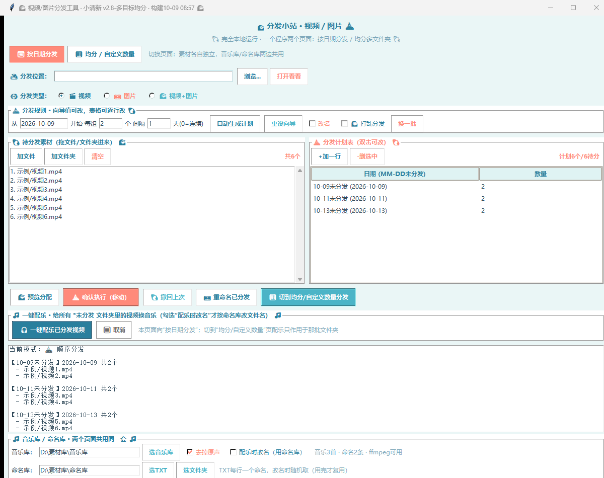
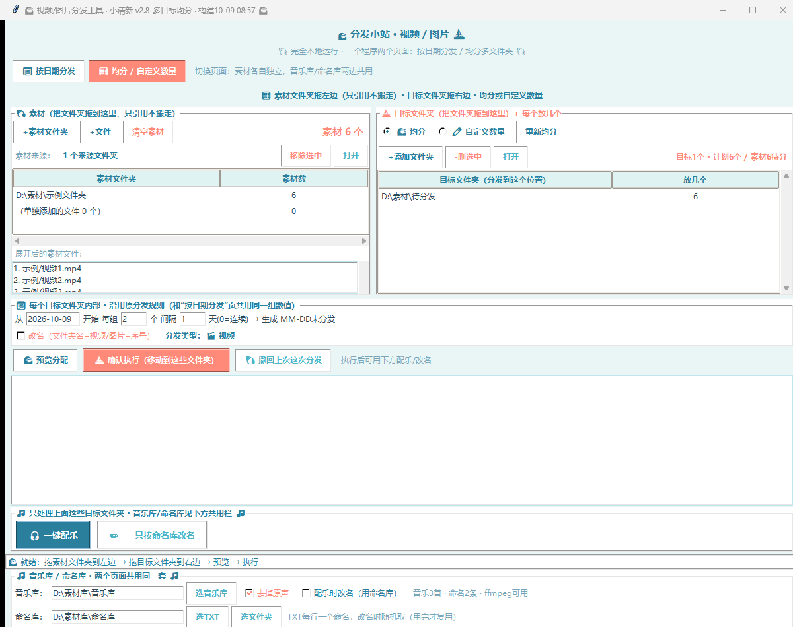
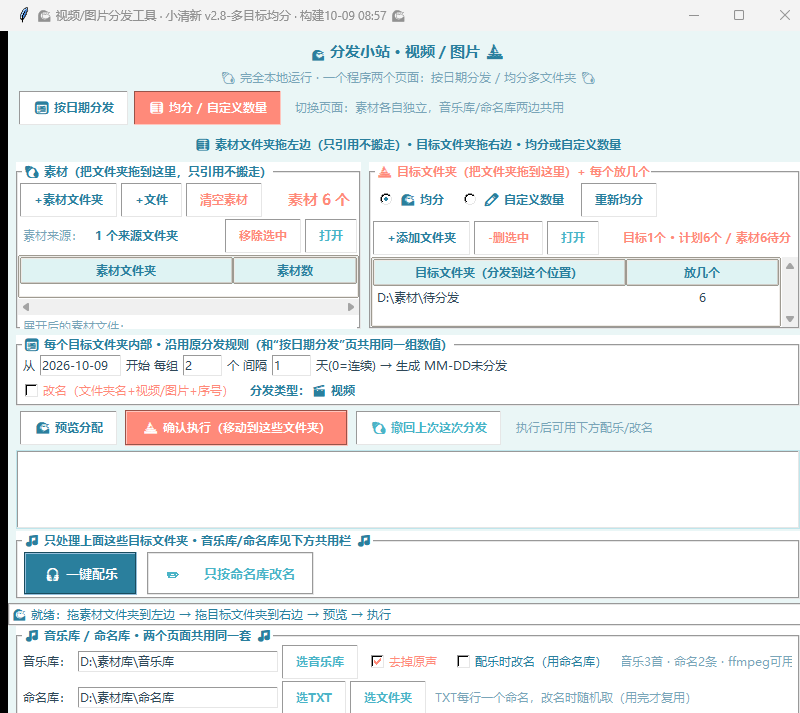

# 视频分发工具 VideoDistributor

一个 Windows 桌面小工具：把一堆视频/图片，按你定的规则自动分拣到
`MM-DD未分发` 日期文件夹里，然后可一键换 BGM、按命名库改名，**全部操作可撤回**。

单文件 Python 源码，零外部服务依赖，**全流程离线运行**。

  

---

## 界面截图

**📅 按日期分发页** —— 投放素材、设规则、自动生成计划表：



**🧮 均分 / 自定义数量页** —— 左侧素材来源、右侧目标文件夹：



窗口缩到最小时底部功能按钮依然完整可见（下限按两页内容自动计算，约 `800x713`）：



> 截图使用演示数据（`D:\素材\...`），不含任何真实素材或本地路径。

---

## 功能一览

同一个窗口里两个页面，共用底部的音乐库/命名库设置。

### 页面一：📅 按日期分发

投放素材 → 设定「起始日期 / 每组数量 / 间隔天数」→ 自动生成计划表 → 预览 → 确认执行（移动文件）。


- 计划表可逐行增删改，支持每组不同数量、任意跳日期
- 文件夹命名 `MM-DD未分发`（月日补零，如 `09-08未分发`），已存在则合并、不删旧文件
- 排序为自然排序：先按所在子文件夹名，再按文件名（`视频2 < 视频10`）
- 每次执行都写 `distribute_log_时间.csv`，可追溯、可撤回

### 页面二：🧮 均分 / 自定义数量

把素材**均分或自定义分配**到若干个你指定的文件夹，每个目标文件夹内部再按上面的日期规则切分。

- 左侧拖入**多个素材来源文件夹**（只引用路径，不复制、不搬走），显示每个来源的数量和素材总数
- 右侧拖入**多个目标文件夹**（任意盘符任意位置），`🌊均分` 或 `✏️自定义数量`（双击表格改「放几个」）
- 每个目标内部沿用同一组日期规则 → `MM-DD未分发` → 改名 → 写日志 → 可撤回

### 配乐与改名

- **一键配乐**：给 `未分发` 文件夹里的视频换 BGM，随机不重复分配。ffmpeg `-c:v copy` 直拷视频流，仅重编音频，多路并发。原片自动备份，可连配乐一起撤回。已配过乐的文件会自动跳过。
- **只按命名库改名**：随机取命名库 TXT 里的名字（批内不重复，用完才复用），写重命名日志，可退回原名。
- 配乐时可勾选「配乐时改名（用命名库）」，一步完成。

### 数据安全（这块花了最多功夫）

- **原地配乐后撤回能逐字节还原原片**：撤回时优先从 `.配乐原片备份_*` 恢复原片（已用 SHA256 实测）
- 撤回一半失败**不会作废整份日志**：失败行另存新日志，提示「关掉占用后重试」
- 撤回时若因原位置被占用而改名，**完成提示里会明确列出**被改名的文件
- 路径比较统一用 `normcase`（Windows 大小写/斜杠不敏感）
- 配置「先写临时文件再原子替换」，断电不会丢设置
- 所有子线程任务都有异常兜底，任何意外都会恢复按钮状态，不会把界面卡死
- 任务进行中禁止切页/退出，防止进度条和弹框被隐藏

---

## 快速开始

### 方式一：直接跑源码（推荐先这样试）

需要 Python 3.9+（Windows 自带 tkinter）。

```bash
git clone https://github.com/guoluobin-dot/video-distributor.git
cd video-distributor
python video_distributor.py
```

就这样，**不需要装任何第三方包**。

### 方式二：装上拖拽支持（体验更好）

```bash
pip install tkinterdnd2
python video_distributor.py
```

不装也能跑，只是不能鼠标拖拽，改用界面上的 `+素材文件夹` / `+添加文件夹` 按钮添加。

### 首次使用要准备什么

| 项目 | 说明 |
| --- | --- |
| **ffmpeg** | 配乐功能必需。从 [ffmpeg.org/download](https://ffmpeg.org/download.html) 下载，放程序同目录，或确保在系统 `PATH` 里。不需要配乐就不用管。 |
| **音乐库/** | 放你**有使用授权**的音乐（`m4a`/`mp3`/`wav`/`aac`/`flac`/`ogg`）。本仓库不含音频，请自行准备。 |
| **命名库/** | 放 TXT，每行一个命名（支持 UTF-8 / UTF-8-BOM / GBK）。改名前会显示「命名X条」计数。 |

配置好之后，界面底部「🎵 音乐库 / 命名库 · 两个页面共用同一套」那一栏就能设好。

界面上：

- `选音乐库` → 选音乐所在文件夹
- `选TXT` → 直接挑命名用的 `.txt` 文件（可按 `*.txt` 筛选、可多选）
- `选文件夹` → 选整个命名库文件夹（里面所有 TXT 一起读）

---

## 打包成 exe

```bash
pip install pyinstaller==6.10.0 tkinterdnd2==0.6.3
python -m PyInstaller --noconfirm VideoDistributor.spec
```

产物在 `dist\VideoDistributor.exe`。把 `ffmpeg.exe` 放在它旁边即可。

也可以直接用 `scripts\build.bat`（Windows）。

**ffmpeg 故意不打包进 exe**：一是体积（ffmpeg 本体几十 MB），二是它有独立许可证，打包进单文件反而让许可声明变得含混。

---

## 目录结构

```
video-distributor/
├── video_distributor.py          # 全部功能，单文件（~4200 行）
├── VideoDistributor.spec         # PyInstaller 打包配置
├── requirements.txt              # 可选依赖说明
├── LICENSE                       # Apache-2.0
├── NOTICE                        # 第三方内容与素材版权声明
├── docs/
│   ├── design.md                 # 设计文档（含各版本变更与踩坑记录）
│   ├── quickstart.md             # 换电脑 / 迁移指南
│   └── screenshots/              # 界面截图（演示数据）
└── scripts/
    └── build.bat                 # 一键打包
```

以下内容**故意不进仓库**（见 `.gitignore` 与 `NOTICE`）：`外部依赖/`（历史遗留的本地大模型运行时，约 12.5GB）、`音乐库/`、`命名库/`、各 `*.exe`、`video_distributor_config.json`（含你的本地路径）、运行日志。

---

## 支持的格式

- 视频：`mp4` `mov` `mkv` `avi` `flv` `wmv` `m4v` `webm`
- 图片：`jpg` `jpeg` `png` `gif` `bmp` `webp` `tif` `tiff`
- 音频（配乐用）：`m4a` `mp3` `wav` `aac` `flac` `ogg`

界面上「分发类型」可切换 视频 / 图片 / 视频+图片。

---

## 常见问题

**Q：配乐点了没反应 / 提示「没有需要配乐的视频」**
已经配过乐的文件会被自动跳过（防止二次配乐 + 二次改名）。这是预期行为，不是故障。

**Q：撤回后发现文件被改了名**
撤回时若原位置被占用了，程序会换个名放回并在完成提示里列出。这是设计如此 —— 宁可改个名，也绝不覆盖或丢文件。

**Q：拖不进去文件**
没装 `tkinterdnd2`。`pip install tkinterdnd2` 后重启，或改用 `+素材文件夹` 按钮。

**Q：窗口拖小了按钮看不见？**
窗口下限会按两页内容的真实最小需求自动计算（当前约 `800x713`），保证所有按钮和底部音乐库栏始终可见。

**Q：需要联网吗？**
不需要。全流程离线，不调用任何在线服务。

---

## 许可与免责声明

源码采用 [Apache License 2.0](LICENSE)。

**请自行确保你处理的素材拥有合法权利。** 本工具用于处理使用者自己的素材，不得用于侵犯他人著作权或其他合法权益的情形。作者不对使用行为承担责任。

本仓库不包含 ffmpeg、音乐、命名文本等第三方内容，详见 [NOTICE](NOTICE)。